<div align="center">

<!-- ═══════════════════════════════════════════════════════════════════════
     ANIMATED COSMIC BANNER — SVG with SMIL animations, no JS required
     Renders on GitHub's SVG-safe sandbox (all animations inline)
     ═══════════════════════════════════════════════════════════════════════ -->



<br/>
<br/>

<a href="https://yrphappynewyearcoep27.netlify.app/" target="_blank">
  
</a>

<br/><br/>

[](LICENSE)
[](https://threejs.org/)
[](https://greensock.com/gsap/)
[](https://www.khronos.org/webgl/)
[](https://www.netlify.com/)

</div>

---

## What Is This?

**Happy New Year 2027** is a browser-native 3D experience that guides visitors through three cinematic acts — a relativistic spacetime tunnel, a winter aurora countdown, and a live fireworks celebration — entirely without any framework or build system. Open `index.html`, and it runs.

The experience is also built to be shared. Anyone can create a personalized greeting link by appending their name to the URL: `?from=Yashraj`. When a friend opens that link, they see a custom greeting before entering the 2027 countdown.

**[→ Open the live experience](https://yrphappynewyearcoep27.netlify.app/)**

---

## The Three Acts

```
ACT I                     ACT II                    ACT III
─────────────────────     ─────────────────────     ─────────────────────
Three.js Wormhole          Aurora Winter Canvas      Dual Canvas Fireworks
                     ──▶                       ──▶
Gravitational Lens         Glassmorphic Countdown    SVG Stroke Calligraphy
GLSL Shaders               Color-Cycling Aurora      Golden 2027 Emblem
Kinetic Typography         Real-Time Timer Tick      Personalized Sharing
Marathi + English          January 1, 2027 Target    WhatsApp / X / Link
```

### Act I — Cosmic Spacetime

A procedural Three.js WebGL tunnel built from a multi-octave Perlin noise geometry. The camera drifts forward through a wormhole while a gravitational lensing GLSL shader bends star-field light around a simulated event horizon. 150,000 star particles fill the surrounding space. Kinetic text sequences in English and Marathi (`"येणाऱ्या वर्षासाठी, एक निशब्द आशा."`) animate in via GSAP using `Intl.Segmenter` grapheme-cluster splitting for precise per-character timing.

### Act II — Winter Aurora Countdown

A painterly mountain and aurora backdrop (CSS animated, no video) hosts a compact glassmorphic card showing the real-time countdown to `January 1, 2027 00:00:00`. The card was deliberately kept small and elegant — the aurora artwork is the centerpiece, not the timer. A single "New Year Now!" button skips directly to Act III.

### Act III — Grand Celebration

A dual HTML5 Canvas particle fireworks engine launches shells that burst with gravity, air resistance, and fading color trails. The "Happy New Year" calligraphy appears via SVG `stroke-dashoffset` animation. A radiant golden **2027** numeral glows beneath it. From here, visitors can open the personalized share modal to generate and send custom greeting links.

---

## Personalized Greeting System

```
You share:  https://yrphappynewyearcoep27.netlify.app/?from=Yashraj
                                                                ↑
                                                        your name here

Your friend opens it and sees:
┌─────────────────────────────────────────────────────┐
│  🎇  Yashraj  sent you a 2027 New Year greeting!    │
│       Tap anywhere to begin the experience →         │
└─────────────────────────────────────────────────────┘
```

The greeting pill appears in the cosmic intro before any audio starts, so it feels like a personal invitation rather than a popup. Share via WhatsApp, X (Twitter), or copy the link directly from the in-experience share modal.

---

## Tech Stack

| Layer | Technology | Purpose |
|---|---|---|
| **3D Engine** | Three.js r163, WebGL 2.0 | Wormhole, star field, lensing shader |
| **GLSL Shaders** | Custom vertex + fragment | Accretion disk, gravitational lensing, Perlin noise |
| **Motion** | GSAP 3.12 | Kinetic text, scene transitions, SVG calligraphy |
| **2D Canvas** | HTML5 Canvas, jQuery 3.6 | Fireworks particle engine, twig growth |
| **Typography** | Cinzel, Montserrat, Tiro Devanagari | Headings, UI, Marathi script |
| **Audio** | HTML5 Audio, Web Audio API | Space ambience → celebration crossfade |
| **Deployment** | Netlify + `netlify.toml` | Static hosting, CDN, security headers |
| **Discoverability** | Schema.org JSON-LD, `llms.txt`, `sitemap.xml` | SEO, GEO, social cards |

No npm. No bundler. No build step. Drop the files on any static host and it works.

---

## Running Locally

```bash
git clone https://github.com/Morningstar777-star/Happy-New-Year-2027.git
cd Happy-New-Year-2027

# Python 3
python -m http.server 8080

# Node.js
npx serve .
```

Visit `http://localhost:8080`. Audio requires a user gesture (browser policy); click or tap anywhere to unlock sound.

---

## Project Structure

```
Happy-New-Year-2027/
│
├── index.html            ← Everything: markup, Three.js shaders, GSAP, Canvas, styles
│
├── start.mp3             ← Cosmic journey atmospheric track
├── celebration.mp3       ← Fireworks celebration music
│
├── favicon.svg           ← 2027 Cosmic Chrono-Nova vector emblem
├── favicon.ico           ← Multi-resolution desktop icon
├── favicon.png           ← 512×512 master icon
├── apple-touch-icon.png  ← iOS home screen (180×180)
│
├── netlify.toml          ← Headers, caching, and security rules
├── robots.txt            ← Crawler permissions (Googlebot, GPTBot, ClaudeBot, etc.)
├── sitemap.xml           ← XML sitemap for search indexing
├── llms.txt              ← Generative Engine Optimization manifest
│
└── LICENSE               ← MIT
```

---

## Discoverability & GEO

Structured data, social cards, and AI search optimization are baked in to maximize organic reach:

- **JSON-LD Schemas**: `WebApplication`, `Event` (New Year 2027), `FAQPage` — feeds Google rich snippets.
- **OpenGraph + Twitter Cards**: Preview cards for WhatsApp, Facebook, X with correct `og:image` and `og:description`.
- **`llms.txt`**: Project architecture manifest for Claude, ChatGPT Search, Perplexity, and Gemini to cite correctly.
- **`robots.txt`**: Allows all major crawlers including `GPTBot`, `ClaudeBot`, `PerplexityBot`, and `Applebot`.
- **Semantic SR Layer**: A hidden `<main class="sr-only">` contains full readable text for screen readers and crawlers without affecting the visual WebGL experience.

---

## Contributing

Pull requests are welcome. For significant changes, open an issue first.

1. Fork the repo
2. Create a feature branch: `git checkout -b feature/your-idea`
3. Commit with a clear message: `git commit -m 'feat: describe what you added'`
4. Push and open a Pull Request

---

## License

MIT. See [LICENSE](LICENSE).

---

<div align="center">

Made by [Yashraj Patil](https://github.com/Morningstar777-star)

**[→ Experience it live](https://yrphappynewyearcoep27.netlify.app/)**

</div>
