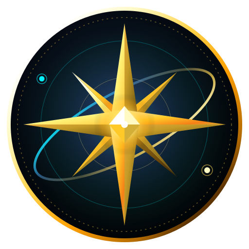

<div align="center">



# Happy New Year 2027

An interactive 3D WebGL countdown and celebration web experience built with Three.js, GSAP, and HTML5 Canvas.

[](https://opensource.org/licenses/MIT)
[](https://threejs.org/)
[](https://greensock.com/gsap/)
[](https://www.khronos.org/webgl/)
[](https://www.netlify.com/)

[Live Demo](https://happy-new-year-2027.netlify.app) &bull; [GitHub Repository](https://github.com/Morningstar777-star/Happy-New-Year-2027)

</div>

---

## Overview

This project guides visitors through a 3-stage visual sequence welcoming 2027:

1. **Cosmic Spacetime Journey**: A Three.js WebGL scene featuring a procedural wormhole tunnel, gravitational lensing shaders around an event horizon, an accretion disk, and kinetic multilingual typography (English and Marathi) driven by GSAP.
2. **Winter Countdown**: A real-time countdown targeting midnight January 1, 2027 (00:00:00) rendered within a compact glassmorphic card over an animated mountain and aurora backdrop.
3. **Grand Celebration**: An interactive dual-canvas particle fireworks display with SVG stroke calligraphy ("Happy New Year"), a golden 2027 emblem, and customizable greeting links.

---

## Features

- **Procedural 3D Shaders**: Three.js WebGL wormhole tunnel with Perlin noise distortion, GLSL gravitational lensing, and interactive camera motion.
- **Multilingual Kinetic Typography**: Text animation with blur, 3D scale, and rotational transitions using GSAP and `Intl.Segmenter`.
- **Targeted Countdown**: Real-time ticker counting down days, hours, minutes, and seconds to 2027 with an immediate preview button.
- **Physics-Based Particle Fireworks**: Canvas particle engine simulating gravity, friction, velocity decay, and color trails.
- **Personalized Greeting Generator**: Supports URL query parameters (`?from=Name`) so visitors can generate customized greeting links for friends and family with integrated sharing options.
- **Audio Crossfade Engine**: Web Audio and HTML5 audio system with smooth transitions between ambient space atmospheric tracks and celebration music, including a floating mute toggle.
- **Search and GEO Optimization**: Structured data (JSON-LD schemas for `WebApplication`, `Event`, and `FAQPage`), OpenGraph and Twitter card metadata, `llms.txt` manifest, `sitemap.xml`, and `robots.txt`.

---

## Tech Stack

| Component | Technology |
|---|---|
| Core | HTML5, CSS3, JavaScript (ES6+) |
| 3D & Graphics | Three.js (r163), Custom GLSL Shaders, WebGL 2.0 |
| Animations | GSAP 3.12, SVG stroke-dashoffset |
| 2D Canvas | HTML5 Canvas, jQuery 3.6 |
| Audio | HTML5 Audio, Web Audio API |
| Deployment | Netlify |

---

## Running Locally

Clone the repository and serve it using any local HTTP server:

```bash
# Clone the repository
git clone https://github.com/Morningstar777-star/Happy-New-Year-2027.git

# Navigate into the project folder
cd Happy-New-Year-2027

# Start a local static server (Python 3)
python -m http.server 8080

# Or with Node.js
npx serve .
```

Open `http://localhost:8080` in your web browser.

---

## Personalized Greetings

You can create a personalized greeting link by adding the `?from=` parameter:

```
https://happy-new-year-2027.netlify.app/?from=YourName
```

When opened, the experience presents a greeting pill noting who sent the wish before transitioning into the celebration screen.

---

## Project Structure

```
Happy-New-Year-2027/
├── index.html           # Main markup, Three.js shaders, styles, and animation logic
├── favicon.svg          # Vector Chrono-Nova brand crest
├── favicon.ico          # Multi-resolution desktop favicon
├── favicon.png          # High-resolution 512x512 application icon
├── apple-touch-icon.png # iOS home screen touch icon
├── start.mp3            # Atmospheric background audio for the opening sequence
├── celebration.mp3      # Audio track for the fireworks celebration
├── netlify.toml         # Netlify headers, cache rules, and security policies
├── robots.txt           # Search engine and crawler instructions
├── sitemap.xml          # XML sitemap
├── llms.txt             # Generative Engine Optimization manifest
├── LICENSE              # MIT License
└── README.md            # Project documentation
```

---

## Contributing

Pull requests are welcome. For major changes, please open an issue first to discuss what you would like to change.

1. Fork the repository
2. Create your feature branch (`git checkout -b feature/improvement`)
3. Commit your changes (`git commit -m 'Add improvement'`)
4. Push to the branch (`git push origin feature/improvement`)
5. Open a Pull Request

---

## License

This project is licensed under the MIT License. See the [LICENSE](LICENSE) file for details.

---

## Author

Created by [Yashraj Patil](https://github.com/Morningstar777-star).
