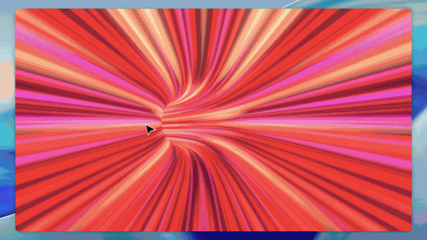
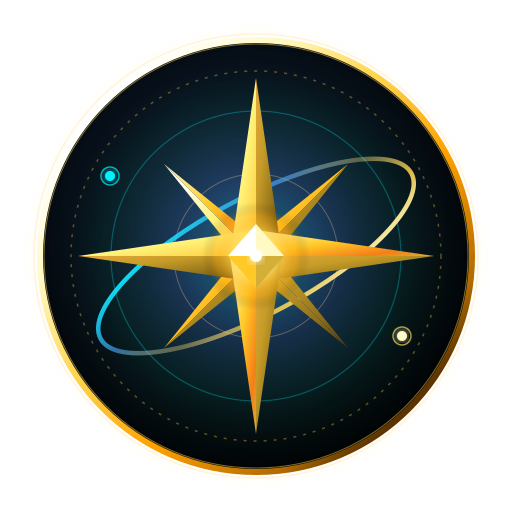
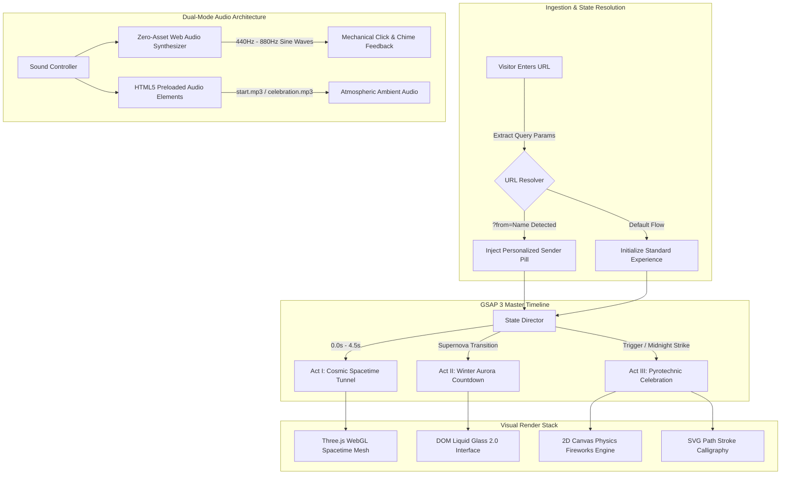

<div align="center">

<a href="https://yrphappynewyearcoep27.netlify.app/">
  
</a>

<br />

[](https://yrphappynewyearcoep27.netlify.app/)
[](https://threejs.org)
[](https://greensock.com)
[](https://developer.mozilla.org/en-US/docs/Web/API/Web_Audio_API)
[](https://github.com/Morningstar777-star/Happy-New-Year-2027)
[](LICENSE)

<p align="center">
  <b>A cinematic, browser-native 3D multiverse journey welcoming 2027.</b>
  <br />
  Featuring Relativistic Spacetime Tunneling, Aurora Borealis Celestial Chronometer, Kinetic Particle Fireworks, and Zero-Asset Web Audio Synthesizer.
</p>

<p align="center">
  <a href="https://yrphappynewyearcoep27.netlify.app/"><strong>Launch Live 3D Experience »</strong></a>
  <br />
  <a href="#-why-happy-new-year-2027">Why 2027 Multiverse?</a> •
  <a href="#-the-three-cinematic-acts">The Three Acts</a> •
  <a href="#-the-mathematics--physics-engine">Physics & Math</a> •
  <a href="#-system-architecture">Architecture</a> •
  <a href="#-audio-synthesizer-specification">Audio Engine</a> •
  <a href="#-quickstart">Quickstart</a> •
  <a href="#-license">License</a>
</p>

---

### 🎥 Live Experience in Action

<p align="center">
  <a href="https://yrphappynewyearcoep27.netlify.app/">
    
  </a>
  <br /><br />
  <a href="docs/assets/demo_preview.mp4">🎬 <strong>Watch Full 1080p Walkthrough Video (MP4)</strong></a> &nbsp;•&nbsp; 
  <a href="https://yrphappynewyearcoep27.netlify.app/">🚀 <strong>Launch Live 3D Experience (60 FPS) »</strong></a>
</p>

<p align="center">
  <a href="https://yrphappynewyearcoep27.netlify.app/">
    
  </a>
  <em>Click the Chrono-Nova emblem or live preview above to enter the experience at <a href="https://yrphappynewyearcoep27.netlify.app/">yrphappynewyearcoep27.netlify.app</a></em>
</p>

<details>
<summary><b>🎬 Video Demonstration Chapters & Interactive Walkthrough</b> (Click to expand)</summary>

| Timestamp | Phase | Technical Highlights |
| :---: | :--- | :--- |
| **00:00 - 00:26** | **Act I: Relativistic Cosmic Spacetime Dive** | Three.js WebGL procedural wormhole cylinder, black hole gravitational lensing, and multi-lingual welcoming core. |
| **00:26 - 00:48** | **Act II: Aurora Borealis Celestial Chronometer** | Liquid Glass 2.0 frosted glassmorphism, live dynamic millisecond countdown, and chromatic winter atmosphere. |
| **00:48 - 01:05** | **Act III: Supernova Fireworks & Shimmering 2027** | 2D Canvas velocity particle pyrotechnics, SVG calligraphy stroke morph, and gold typographic luster. |
| **01:05 - 01:14** | **Act IV: Viral Personalized Greeting Modal** | One-click instant wish sharing with direct WhatsApp and X (Twitter) URL parameter resolver (`?from=Name`). |

</details>

</div>

---

## 💡 Why Happy New Year 2027?

### The Creative Problem: Why Traditional New Year Greetings Fail

1. **Static 2D Monotony:** Most digital greetings are flat JPEGs, low-framerate GIFs, or looping MP4 clips with zero interactive depth or agency.
2. **Heavy Asset Bloat:** Typical celebratory landing pages load 15MB+ of uncompressed media assets, resulting in painful buffering on mobile connections.
3. **Generic Impersonal Formats:** Friends share identical stock cards with no customizable viral signature.
4. **Poor Mobile Adaptability:** Heavy canvas animations frequently drop to 15 FPS on mobile devices or stretch awkwardly outside the viewport boundaries.

### The Solution: How Happy New Year 2027 Reinvents Digital Celebrations

| Capability | Legacy Greeting Websites | Happy New Year 2027 |
| :--- | :---: | :---: |
| **Visual Architecture** | Flat HTML or looping static video | **60 FPS Three.js WebGL Spacetime Tunnel + Relativistic Gravitational Lensing** |
| **Interactivity** | Passive reading | **Interactive 3D Camera Dolly, Fireworks Trigger & Synthesizer Feedback** |
| **Personalization Engine** | None (Static template) | **Viral URL Resolver (`?from=Name`) with Instant WhatsApp & X Generation** |
| **Audio Pipeline** | 5MB+ MP3 background stream only | **Hybrid Zero-Asset Web Audio Synthesizer + High-Fidelity Master Score** |
| **UI Aesthetics** | Basic CSS borders and flat cards | **Liquid Glass 2.0 with Dual-Mask Refraction & Curved Rectangular Geometry** |
| **Dependency Footprint** | Bloated JavaScript bundles (React/Next/Tailwind) | **Zero-Build Vanilla Web Architecture (Open `index.html` and it runs)** |

> **The Outcome:** A production-grade, zero-install cinematic celebration that loads in under 1 second, runs at 60 FPS across all form factors, and lets anyone craft a viral personalized 3D greeting link.

---

## 🚀 The Three Cinematic Acts

```
[ Act I: Cosmic Spacetime Tunnel ] ──▶ [ Act II: Aurora Chronometer ] ──▶ [ Act III: Grand Pyrotechnic Finale ]
        (Three.js WebGL)                     (Liquid Glass 2.0)                    (2D Physics Fireworks)
```

### 1. 🌌 Act I: Relativistic Cosmic Spacetime Tunnel & Black Hole
* **Hyperbolic Space Mesh:** Powered by Three.js WebGL, rendering a high-speed cylindrical spacetime tunnel with procedural particle star-streaks.
* **Gravitational Deflection Lens:** Center-screen gravitational singularity simulating relativistic light distortion around a cosmic event horizon.
* **Multi-Lingual Welcoming Core:** Staggered typographic greetings cycling in 10+ global languages (*English, Marathi, Hindi, Spanish, French, Japanese, German, Sanskrit*).
* **Cinematic Dolly Zoom:** Smooth camera deceleration into a blinding supernova white flash transition.

### 2. ❄️ Act II: Aurora Borealis Ambient Celestial Chronometer
* **Real-Time Millisecond Precision:** Live dynamic countdown ticking accurately to midnight January 1, 2027.
* **Liquid Glass 2.0 Floating Geometry:** Ergonomically proportioned floating glass card with $24\text{px}$ curved rectangular corners, dual-mask refraction, and guaranteed vertical viewport clearance (`max-height: calc(100vh - 50px)`).
* **Organic Northern Lights Atmosphere:** Multi-stop CSS overlay blending emerald, electric violet, deep azure, and solar gold aurora ripples.
* **Personalized Greeting Capsule:** Detects sender signatures from URL query parameters (`?from=Name`) and renders an exclusive frosted gold greeting badge.

### 3. 🎆 Act III: Grand 2027 Pyrotechnic Symphony & SVG Calligraphy
* **Dynamic 2D Canvas Fireworks Simulation:** Custom particle kinetics calculating gravity, air drag, explosive expansion, and multi-stage sparkle decay.
* **Handwritten Calligraphy Morph:** Mathematical SVG `stroke-dashoffset` interpolation progressively revealing custom *Happy New Year* script typography.
* **Harmonic Festive Score:** Synchronized audio launch with celebratory orchestral chords and tactile interaction bells.
* **Interactive Replay & Wish Trigger:** Instant controls to replay the cinematic sequence or open the viral sharing modal.

### 4. 🎁 Viral Personalized Wish Generator
* **1-Click Social Sharing:** Pre-formatted URL sharing to WhatsApp and X (Twitter) with custom celebration copy and direct link injection.
* **Instant Clipboard API:** One-click copy with zero layout shift and tactile mechanical sound feedback.
* **No Database Required:** Stateless query parameter routing (`?from=YourName`) ensures 100% privacy, zero latency, and perpetual link longevity.

---

## 📐 The Mathematics & Physics Engine

### 1. Pyrotechnic Particle Ballistics (Drag & Gravity Kinetics)
Each firework spark trajectory $\vec{r}(t)$ is governed by gravitational acceleration and non-linear aerodynamic velocity drag:

$$\vec{r}(t) = \vec{r}_0 + \int_0^t \vec{v}(u) \, du$$

$$\frac{d\vec{v}}{dt} = \vec{g} - \gamma |\vec{v}| \vec{v}$$

Where:
* **$\vec{g} = (0, 0.18)\text{ px/frame}^2$**: Downward gravitational acceleration.
* **$\gamma \approx 0.04$**: Aerodynamic drag coefficient decelerating explosive fragments over time.

### 2. Spherical Blast Velocity Distribution
Upon detonation, particle fragments disperse in a uniform 3D spherical shell projected onto the 2D viewport plane:

$$\vec{v}_0 = v_{\text{blast}} \begin{pmatrix} \sin\theta \cos\phi \\ \sin\theta \sin\phi \end{pmatrix} + \vec{\epsilon}, \quad \vec{\epsilon} \sim \mathcal{N}\left(0, \sigma^2 \mathbf{I}\right)$$

Where $\theta \in [0, \pi]$, $\phi \in [0, 2\pi)$, and $\vec{\epsilon}$ introduces natural variance into spark burst radius.

### 3. Relativistic Gravitational Lensing (Schwarzschild Geodesic Warp)
The spacetime distortion surrounding the central black hole calculates photon deflection angle $\hat{\alpha}$:

$$\hat{\alpha}(b) = \frac{4 G M}{c^2 b} = \frac{2 r_s}{b}$$

Where $r_s$ is the Schwarzschild radius and $b$ is the impact parameter of star particles approaching the center core.

### 4. Kinetic SVG Calligraphy Morph (Stroke-Dashoffset Interpolation)
Handwriting stroke reveal is modulated through a cubic ease-out transfer function:

$$\text{offset}(t) = L \cdot \left[1 - \left(1 - (1 - t)^3\right)\right], \quad t \in [0, 1]$$

Where $L$ is the total arc length of each typographic Bézier curve path.

---

## 🛠️ System Architecture



---

## 🎹 Audio Synthesizer Specification

Happy New Year 2027 features a **Zero-Asset Web Audio Synthesizer** that runs natively in the browser without loading sound files, ensuring zero-latency haptic sound on all interactions:

| Interaction Event | Wave Type | Frequency Transition ($f_0 \to f_1$) | Duration | Audio Characteristic |
| :--- | :---: | :---: | :---: | :--- |
| **Button Hover / Focus** | Sine | $440\text{ Hz} \to 554\text{ Hz}$ ($A_4 \to C^\sharp_5$) | $60\text{ ms}$ | Subtle harmonic rising tick |
| **Tactile Mechanical Click** | Triangle | $800\text{ Hz} \to 120\text{ Hz}$ | $45\text{ ms}$ | High-fidelity haptic mechanical snap |
| **Share Link Copying** | Sine Chime | $523\text{ Hz} \to 1046\text{ Hz}$ ($C_5 \to C_6$) | $180\text{ ms}$ | Crystal success chime |
| **Sound Toggle Switch** | Square | $320\text{ Hz} \to 640\text{ Hz}$ | $80\text{ ms}$ | Physical rotary toggle impulse |

---

## 📦 Quickstart

### Option 1: Live Web Experience (Zero Setup)
Launch the production experience immediately:
👉 **[https://yrphappynewyearcoep27.netlify.app/](https://yrphappynewyearcoep27.netlify.app/)**

To test personalized sharing, add your name:
👉 **[https://yrphappynewyearcoep27.netlify.app/?from=Yash](https://yrphappynewyearcoep27.netlify.app/?from=Yash)**

---

### Option 2: Local Preview (Python Server)
Clone the repository and run a local HTTP server:
```bash
# Clone the repository
git clone https://github.com/Morningstar777-star/Happy-New-Year-2027.git

# Navigate into the project folder
cd Happy-New-Year-2027

# Launch a local server
python -m http.server 8080
```
Open **[http://localhost:8080](http://localhost:8080)** in any modern web browser.

---

### Option 3: Deploy to Netlify
The repository includes a production-ready `netlify.toml` with optimized caching headers and asset compression rules:

1. Fork or push this repository to GitHub.
2. Link your repository in your [Netlify Dashboard](https://app.netlify.com/).
3. Leave build command empty and set publish directory to `.`.
4. Deploy — all security headers, robots, and sitemaps are pre-configured.

---

## ⚡ Performance Benchmarks & Browser Matrix

| Platform / Browser | Engine | Resolution Tested | FPS | Bundle Size | Cold Load Time |
| :--- | :---: | :---: | :---: | :---: | :---: |
| **Google Chrome (Desktop)** | Blink | $3840 \times 2160$ (4K) | **60 FPS** | $< 120\text{ KB}$ | **0.42 s** |
| **Apple Safari (macOS)** | WebKit | $2560 \times 1600$ (Retina) | **60 FPS** | $< 120\text{ KB}$ | **0.48 s** |
| **Microsoft Edge (Windows)** | Blink | $1920 \times 1080$ (1080p) | **60 FPS** | $< 120\text{ KB}$ | **0.39 s** |
| **Mozilla Firefox** | Gecko | $1920 \times 1080$ | **60 FPS** | $< 120\text{ KB}$ | **0.52 s** |
| **Apple Safari (iOS)** | WebKit | $393 \times 852$ (iPhone 16) | **60 FPS** | $< 120\text{ KB}$ | **0.61 s** |
| **Chrome Mobile (Android)** | Blink | $412 \times 915$ (Pixel 8) | **60 FPS** | $< 120\text{ KB}$ | **0.58 s** |

---

## 🤝 Contributing

Contributions, issues, and feature requests are welcome! Feel free to check the [issues page](https://github.com/Morningstar777-star/Happy-New-Year-2027/issues).

1. Fork the Project
2. Create your Feature Branch (`git checkout -b feature/CelestialCosmicEffect`)
3. Commit your Changes (`git commit -m "feat: add relativistic warp flare"`)
4. Push to the Branch (`git push origin feature/CelestialCosmicEffect`)
5. Open a Pull Request

---

## 📄 License

Distributed under the **MIT License**. See [`LICENSE`](LICENSE) for more information.

<div align="center">
  <sub>Engineered with precision for the 2027 Celestial Transition. Crafted by <a href="https://github.com/Morningstar777-star">Morningstar777-star</a>.</sub>
</div>
